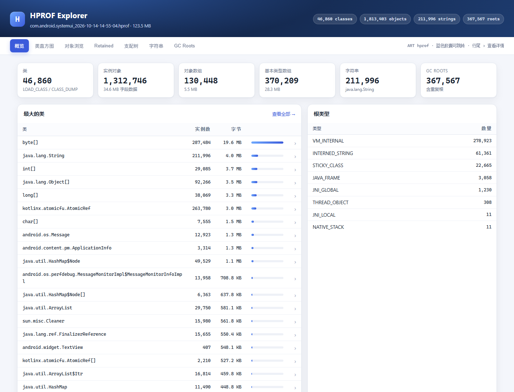
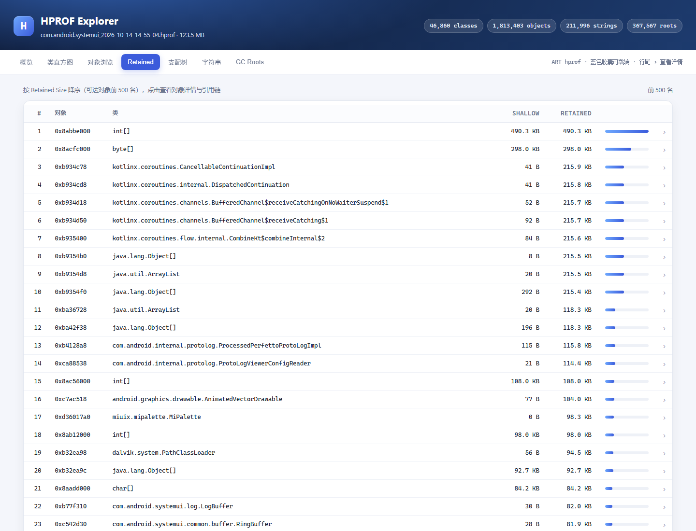
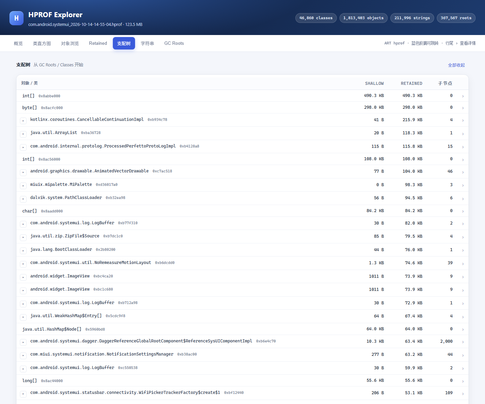
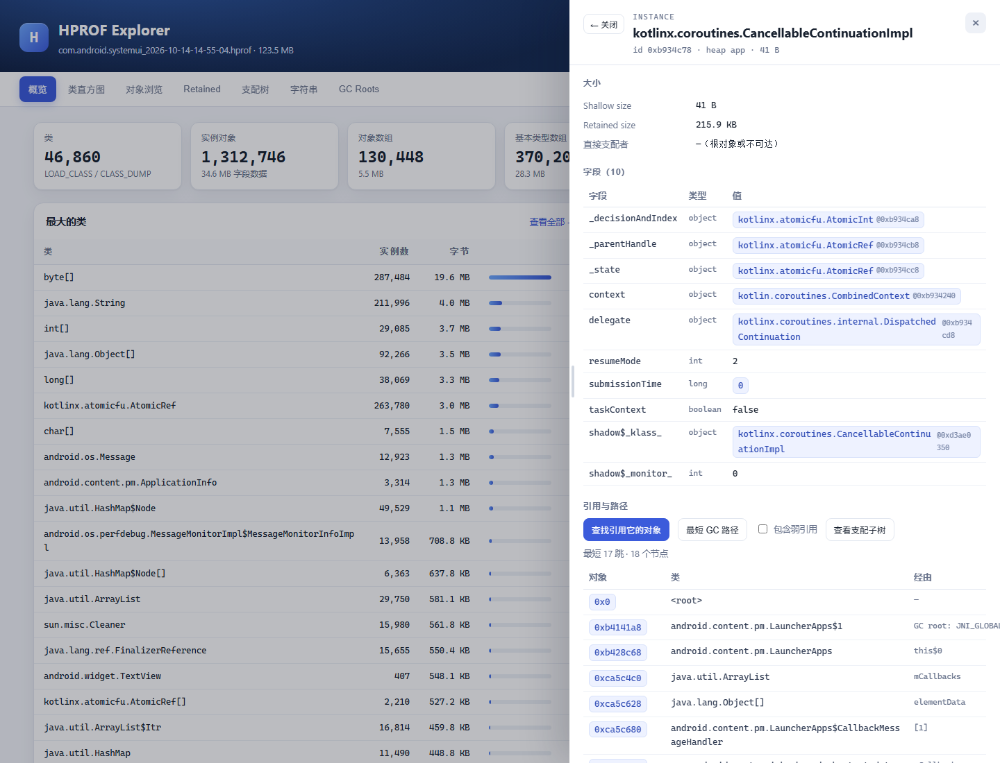
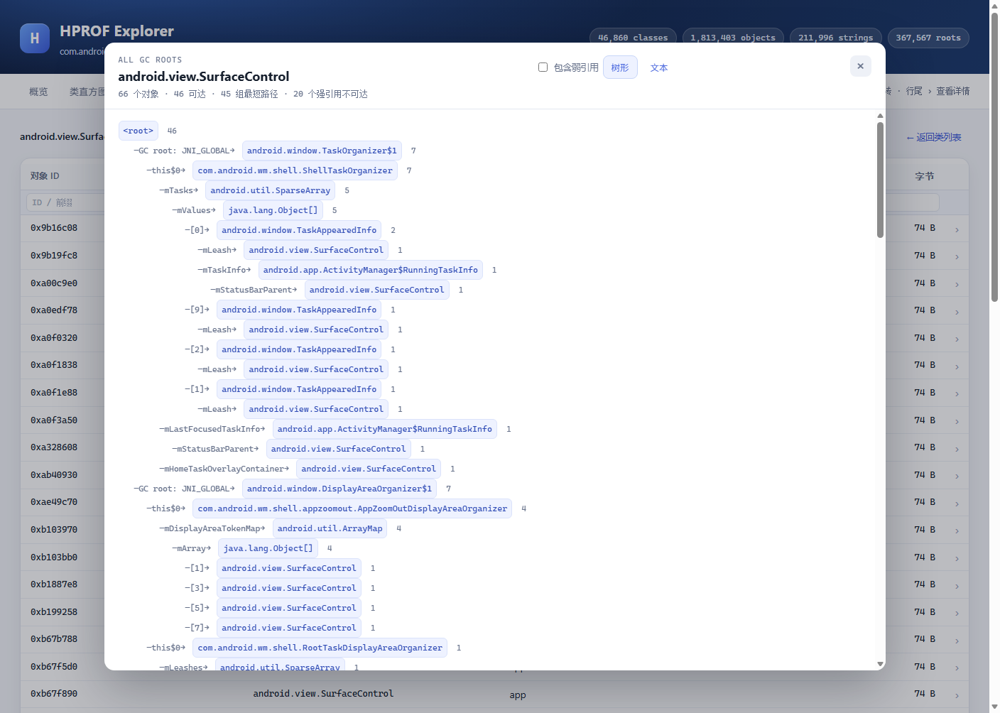

# HPROF Explorer

一个零依赖的 Android/ART hprof 解析器 + Web 可视化界面。用来查看 `am dumpheap` 抓下来的 Java 堆：类直方图、对象、字段、引用、字符串、GC Roots，以及支配树（Retained Size）和到 GC Root 的引用链。

维护与实现细节见 [docs/DESIGN.md](docs/DESIGN.md)。



## 运行

```bash
# Node.js >= 20
node src/server.mjs --hprof <path/to/dump.hprof> [--port 8787] [--host 127.0.0.1]
```

如果 `data/` 下只有一个 `.hprof`，可以省略 `--hprof`：

```bash
node src/server.mjs
```

Windows 下也可以直接运行 `start.cmd`（等价于上面的自动发现）。

然后打开 <http://127.0.0.1:8787>。

如果拿到的是 zip，先解压出 `.hprof`：

```bash
unzip com.android.systemui_..._hprof.zip -d data
node src/server.mjs --hprof data/com.android.systemui_....hprof
```

只看统计、不起服务：

```bash
node src/stats.mjs data/dump.hprof
```

### 接入 DeepSeek Harness

`dsh-plugin/` 是把本工具做成 Harness 原生能力的插件：通用 `hprof_api` 服务入口、`hprof_*` 工具、独立引擎进程、同源 `/hprof-api` 路由，以及 Harness 主面板里的分析工作区 + 完整对话（不是 iframe）。安装与配置见 [dsh-plugin/README.md](dsh-plugin/README.md)。

## 功能

- **概览**：类/实例/数组/字符串/Root 数量，实例字段与数组字节数，逻辑堆（app/zygote/image），最大的类、最长可读字符串、根类型分布。
- **类直方图**：按字节、实例数或名称排序，支持类名过滤；点击进入该类的对象列表。
- **对象浏览**：分页查看某个类的实例，显示对象 ID、类、所在堆、浅大小；表头支持按对象 ID、类名、堆、最小字节过滤。
- **表头过滤**：类直方图（类名/实例数/字节）、对象（ID/类/堆/字节）、字符串（ID/长度/内容）、GC Roots（ID/类/根类型/堆）、Retained（ID/类/最小 Retained）都有表头输入框，服务端过滤后再分页；支配树工具栏支持按类名/ID 过滤当前层。
- **对象详情**：Shallow / Retained Size、直接支配者、字段名/类型/值，对象引用可点击跳转；数组元素；String 完整内容；类对象显示父类、实例大小、静态字段。
- **详情历史导航**：点引用跳转会产生详情历史，左上角“← 返回”回到上一个对象（Alt+← 同效）；只有一条时按钮变成“关闭”，Esc 也能关闭。切换页签会自动关闭详情，避免遮挡。
- **Retained Size 排行**：对可达对象计算支配树，按 Retained Size 列出前 500 名，点击查看对象和引用链。
- **支配树树形浏览**：按层展开/收起，每层按 Retained Size 排序；任意对象详情里点“查看支配子树”可以从该对象往下浏览，也可以随时回到根；从详情进入后工具栏还有“返回对象详情”。
- **类级 GC Root 路径**：选中一个类，一次性计算它所有对象到 GC Root 的最短路径，并按路径合并展示（对象数、Shallow 合计、示例对象），对应 MAT 的 “Path to GC Roots / all objects of a class”。支持**树形缩进**和**纯文本**两种展示，并可勾选“包含弱引用”。
- **最短 GC 路径**：对象详情里的“最短 GC 路径”使用从 super-root 出发的 BFS 最短路径树，显示跳数和完整的引用链；默认只看强引用，可勾选“包含弱引用”。
- **可拖拽详情面板**：对象详情右侧抽屉可以拖动左边缘调整宽度，双击复位，宽度记忆在 localStorage。
- **到 GC Root 的路径**：沿反向引用边 BFS 到最近的根/类，输出完整链条，并标注每一步的字段/数组下标/静态字段。
- **引用查询**：按需扫描整个堆，找出哪些对象/字段引用了目标对象（带超时与截断标记）。
- **字符串**：默认过滤掉二进制/ICU 之类的不可读内容，可按内容搜索（例如“设置”“通知”），也可关闭过滤查看全部。
- **GC Roots**：根类型统计与根对象列表。

### Retained Size 与引用链



### 支配树树形浏览



- 根节点是 GC Roots / Classes；每一层默认展示 Retained Size 前 100 个节点，可“显示更多”。
- 有子节点的行左侧有 ▸/▾ 展开按钮；点击行本身（或行尾 ›）打开对象详情。
- 详情里的“查看支配子树”会以当前对象为根重新加载树，工具栏的“回到支配树根”返回全局视图。

- 节点：实例、对象数组、基本类型数组、类对象；另加一个 super-root。
- 边：实例 object 字段、对象数组元素、类的父类/ClassLoader/静态字段；super-root 指向所有 GC Roots 和所有类对象。
- 支配者用 **Lengauer-Tarjan** 计算，Retained Size 为支配子树内 Shallow Size 之和；不可达对象不参与排行。
- 引用链从目标对象沿 **反向边 BFS** 到最近的根/类，再用父对象的字段表反查“经由”的字段名。

对 129 MB、1.86M 节点、4.9M 边的 SystemUI dump：解析约 1.3 s，支配树约 3.7 s，内存约 0.9 GB。



### 类级 GC Root 路径



- 在对象浏览页（选中某个类后）点 **GC Root 路径**，或在类详情里点 **分析该类所有对象的 GC Root 路径**。
- 服务端先用 BFS 从 super-root 建立最短路径树，再为每个对象回溯到根；相同“类名 + 字段”链会合并成一组。
- 默认 **树形缩进**（共享前缀合并、显示每组对象数），可切换 **文本** 查看每组完整链条和示例对象。
- 每组显示对象数、Shallow 合计、完整链条和示例对象（可点击打开详情）。
- 默认最多分析 20000 个对象、展示前 100 组；超大类会标注“仅分析前 N 个”。
- 默认排除 `WeakReference/SoftReference/PhantomReference.referent`；勾选 **包含弱引用** 后会改用包含弱引用边的 BFS 路径树，并在链上标记 `referent (weak)`。

### 关于“乱码”字符串

有些 `java.lang.String` 里存的是二进制/ICU/加密数据（例如以 U+FFFF 开头、包含大量控制字符），它们本身就不是可读文本。工具会把这些标成 `binary`，默认的“只看可读文本”会过滤掉；真正的中文资源字符串（如“如果您不想让 … 打开设置”）会正常显示，也可以用字符串搜索直接定位。

## 解析实现

`src/hprof.mjs` 直接按字节解析，不依赖第三方库：

- 文件头 `JAVA PROFILE 1.0.3`，4 字节大端 ID（ART 写的是对象地址低 32 位）。
- 顶层记录：`STRING`、`LOAD_CLASS`、`STACK_TRACE`、`HEAP_DUMP_SEGMENT`、`HEAP_DUMP_END`、`0xA0 ART_CLOCK_MONOTONIC`。
- 堆子记录：根、`HEAP_DUMP_INFO`、`CLASS_DUMP`、`INSTANCE_DUMP`、`OBJECT_ARRAY_DUMP`、`PRIMITIVE_ARRAY_DUMP`。
- 字符串按 Java modified UTF-8 解码；String 的字符数据通过合成的 `value` 字段找到对应的 byte[]/char[]。
- 字段值按需解码：只为当前查看的对象计算字段，避免把上百万对象的字段全部展开。
- `$classOverhead`、`$class$`、`shadow$_klass_` 等 ART 合成字段会原样显示。
- 逻辑堆通过 `HEAP_DUMP_INFO` 维护偏移区间，对象详情按记录偏移二分查找所属堆。

## HTTP API

| 路径 | 说明 |
| --- | --- |
| `/api/summary` | 元数据、计数、类直方图、根统计、Top 类/字符串、分析耗时 |
| `/api/classes?q=&sort=bytes\|count\|name` | 类直方图 |
| `/api/instances?kind=class\|primitive&id=&page=&size=&fid=&className=&heap=&minSize=` | 某个类的对象分页（表头过滤） |
| `/api/object?id=` | 对象/类详情（含 retained / dominator） |
| `/api/classpaths?kind=class\|primitive&id=&limit=&weak=1` | 某个类所有对象的 GC Root 路径分组 |
| `/api/retained?page=&size=` | Retained Size 排行 |
| `/api/path?id=&weak=1` | 最短 GC 路径（可选弱引用） |
| `/api/referrers?id=` | 扫描引用目标的对象 |
| `/api/strings?page=&size=&q=&readable=1` | 字符串列表/搜索 |
| `/api/roots?page=&size=` | GC Roots 列表 |

## 限制

- 只支持 4 字节 ID 的 Android hprof（ART 固定这样写）；标准 JVM 的 8 字节 ID dump 会直接报错。
- 支配树只计算从根/类可达的对象；不可达对象不参与 Retained Size 排行。
- 弱引用语义：`WeakReference/SoftReference/PhantomReference.referent` 边默认从支配树和路径中排除；需要检查弱引用时可在对象路径/类路径里勾选“包含弱引用”（会标记 `referent (weak)`）。`FinalizerReference` 仍按普通引用处理，JNI 句柄内部关系也不在引用链里。
- 类级 GC Root 路径按最短路径（BFS）计算，默认最多分析 20000 个对象、展示前 100 组；同一对象的其他合法路径可能不同。
- `referrers` 是每次按需全堆扫描，超大堆上会慢，默认 3 秒后截断。
- 解析和支配树结果常驻内存，129 MB 的 SystemUI dump 约占 0.9 GB；超大 dump 请调大 `--max-old-space-size`。

## 目录

```
src/hprof.mjs   解析、索引、支配树、引用链
src/server.mjs  HTTP 服务 + JSON API
src/stats.mjs   命令行统计
public/         前端（原生 HTML/CSS/JS，无构建步骤）
dsh-plugin/     DeepSeek Harness 插件（hprof_api 服务 + 工具 + 引擎进程 + 工作区）
data/           本地 hprof（已加入 .gitignore）
docs/DESIGN.md  设计、实现原理、进度与维护指南
```
